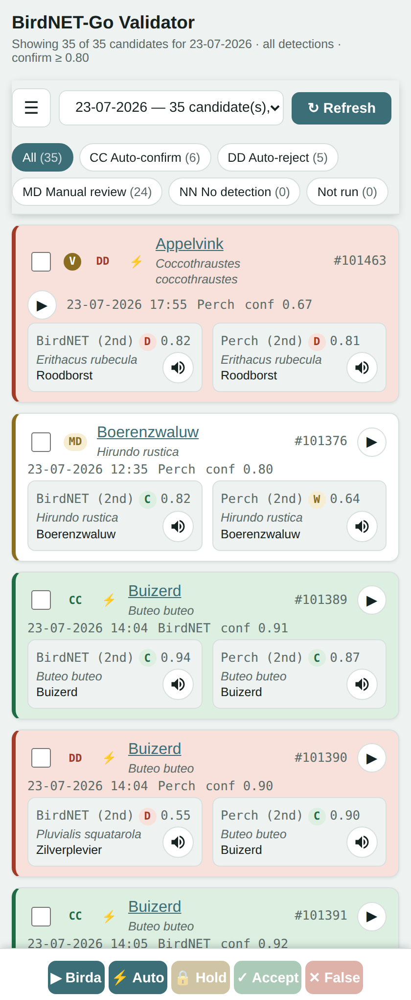

# BirdNET-Go Validation Webapp

A small companion webapp for [BirdNET-Go](https://github.com/tphakala/birdnet-go)
that flags recent detections worth a second opinion, re-classifies their
audio clips with an independent tool ([birda](https://github.com/tphakala/birda)),
and lets you review/accept/reject them from your phone — writing the
result straight back into BirdNET-Go via its own web API.

It does **not** replace BirdNET-Go's own review UI — it's a triage layer
on top of it, focused on the last ~7 days of detections.

<p align="center">
  
</p>

Each candidate is one card: BirdNET-Go's original call on top, then what
the two independent models made of the same clip. The letter pill is the
combined verdict — **CC** auto-confirm, **DD** auto-reject, **MD** manual
review, **NN** no detection — and the card's left border repeats it as
colour. Tap a species name to open it in BirdNET-Go, the ▶ to hear the
clip, or a 🔊 to hear a xeno-canto reference recording of what the model
*thought* it heard. Accept/False/Hold apply to everything you've ticked.

## How it decides what to show you

By default **every detection in the rolling ~7-day window is a candidate**.
The filtering that does the real work is the exclude list: copy
`excluded_species.example.txt` to `excluded_species.txt` (gitignored,
personal to your setup) and list the species you never want to see, one
Dutch common name per line — the birds your setup hears constantly and has
no doubt about. See that file for the exact format.

Optionally you can also narrow by **daily rarity** — keeping only species
with between 1 and N total detections on that local calendar day, on the
idea that a species your setup rarely hears is likelier to be a
misidentification than one it hears all day. This is **off by default**
(tick the rarity box in the hamburger menu, or pass `--rarity` to
`find_candidates.py`); once the exclude list is doing its job, rarity is
more useful as an occasional lens than as the main gate. See
`candidate_finder.py` for the query.

Each candidate's clip is then re-classified by two independent birda
models (`birdnet-v24` and `perch-v2`), each scored per-model as **confirm**
(matches BirdNET-Go's original species, above the confidence threshold),
**weak_match** (same species, below the threshold), **disagree** (a
different species), or **no_detection**. The two are combined into an
overall verdict:

- **auto_confirm (CC)** — both models confirm. Safe to auto-accept.
- **auto_reject (DD)** — the models disagree with each other, or one found
  nothing while the other didn't cleanly confirm. Safe to auto-reject.
- **manual_review (MD)** — both models agree on the species, but at least
  one is below the confidence threshold — a real judgment call, worth a
  listen (use the 🔊 xeno-canto button).
- **no_detection (NN)** — neither model detected anything in the clip.
- **not_run** — birda hasn't verified this clip yet.

The webapp's ⚡ Auto button (bulk, or per-row) writes CC/DD verdicts back to
BirdNET-Go in one action; MD/NN are left for manual Accept/False positive.

**🔒 Hold** is a third option, independent of accept/reject: it locks the
detection in BirdNET-Go, which also exempts its clip from BirdNET-Go's own
disk-usage retention purge. That makes it a "keep this for a proper listen
later" marker — useful because the candidate window only reaches back 7
days, and clips age out. Held detections are browsable any time via the
**🔒 Locked** entry in the day dropdown, regardless of age, and stay
visible on their own day even after you've reviewed them. The **G**/**V**
pill on a card says where the lock came from: **G** for one set in
BirdNET-Go's own GUI, **V** for one set here.

Next to each model's guess, the 🔊 button fetches a few reference
recordings of that species from [xeno-canto](https://xeno-canto.org) (via
their API v3) so you can compare by ear. This needs `XENO_CANTO_API_KEY` set
in `.env` — get one from your xeno-canto account page (requires a verified
email) or register an app-specific key. Without it, the button just reports
that no key is configured; everything else works fine.

Playing a clip shows a small spectrogram preview button in the player bar —
click it to pop up BirdNET-Go's own full labeled spectrogram (fetched
directly from its `/api/v2/spectrogram` endpoint; BirdNET-Go's own detection
page can't be embedded, since it sends its own frame-blocking headers). The
player also has gain, low-cut filter, and normalize controls, built with the
Web Audio API, for a closer listen on windy or quiet clips.

## Requirements

- Python 3.9+ (stdlib only — no pip install needed for this repo itself)
- A running BirdNET-Go instance with clip export enabled, reachable over
  HTTP
- [birda](https://github.com/tphakala/birda) installed — download a release
  build for your platform, then:
  ```
  birda models install birdnet-v24
  birda models install perch-v2
  ```

## Setup

1. Clone this repo next to (or anywhere relative to) your BirdNET-Go data.
2. Copy `.env.example` to `.env` and fill in the values for your setup —
   at minimum you'll usually need `BIRDNETGO_DATA_DIR` (if it's not at
   `~/birdnet-go-app/data`) and `BIRDNETGO_WEB_URL` (if `localhost` won't
   resolve from your phone/laptop). See `config.py` for every available
   variable and its default.
3. Run it:
   ```
   python3 webapp/server.py
   ```
   or install it as a systemd service (see below) so it survives reboots.
4. Open `http://<this-machine's-LAN-IP>:8091` (or whatever `WEBAPP_PORT`
   you set) from your phone or laptop.

### Running as a systemd service (optional)

```ini
# /etc/systemd/system/birdnet-validator.service
[Unit]
Description=BirdNET-Go Validation Webapp
After=network.target

[Service]
Type=simple
User=youruser
WorkingDirectory=/path/to/birdnetgovalidator/webapp
ExecStart=/usr/bin/python3 /path/to/birdnetgovalidator/webapp/server.py
Restart=always
RestartSec=5

[Install]
WantedBy=multi-user.target
```

Then `sudo systemctl enable --now birdnet-validator`.

## Files

| File | Purpose |
|---|---|
| `config.py` | All configuration, env-var overridable (see `.env.example`) |
| `candidate_finder.py` | Picks which recent detections need review (reads BirdNET-Go's DB read-only) |
| `locked_finder.py` | Finds held/locked detections of any age, for the Locked view |
| `excluded_species.example.txt` | Template for `excluded_species.txt`, species to always skip |
| `verifier.py` | Runs birda against candidate clips, computes verdicts |
| `cleanup.py` | Prunes cache entries and birda result files for detections that have aged out of the 7-day window |
| `birdnetgo_client.py` | All writes back to BirdNET-Go — goes through its own HTTP API, never the DB directly |
| `webapp/server.py` | Stdlib HTTP server: serves the UI, candidate/day APIs, audio streaming, review actions |
| `webapp/index.html` | The UI itself — single file, no build step, no framework |
| `find_candidates.py` | CLI wrapper for manual/scripted candidate inspection |
| `verify_candidates.py` | CLI wrapper for manual/scripted verification runs |

## Notes

- Everything the webapp writes to BirdNET-Go (accept/reject, verification
  comments) goes through BirdNET-Go's own `/api/v2/...` endpoints — the
  same ones its GUI uses. Nothing here writes to BirdNET-Go's SQLite DB
  directly; all DB access is read-only.
- The candidate list is always computed live from the DB on each request —
  never cached to a static file — since new detections stream in
  continuously.
- `birda`'s `-o` output naming isn't model-specific (a known upstream
  quirk), so `verifier.py` always uses a separate output directory per
  model to avoid one run's results silently overwriting another's.
- `verification_cache.json` and `birda_results/` only ever need entries for
  detections inside the app's fixed 7-day window — anything older is dead
  weight that just accumulates forever. The 🧹 Cleanup button (hamburger
  menu) prunes both; it's safe to run any time, since it never removes
  anything still inside that window.
